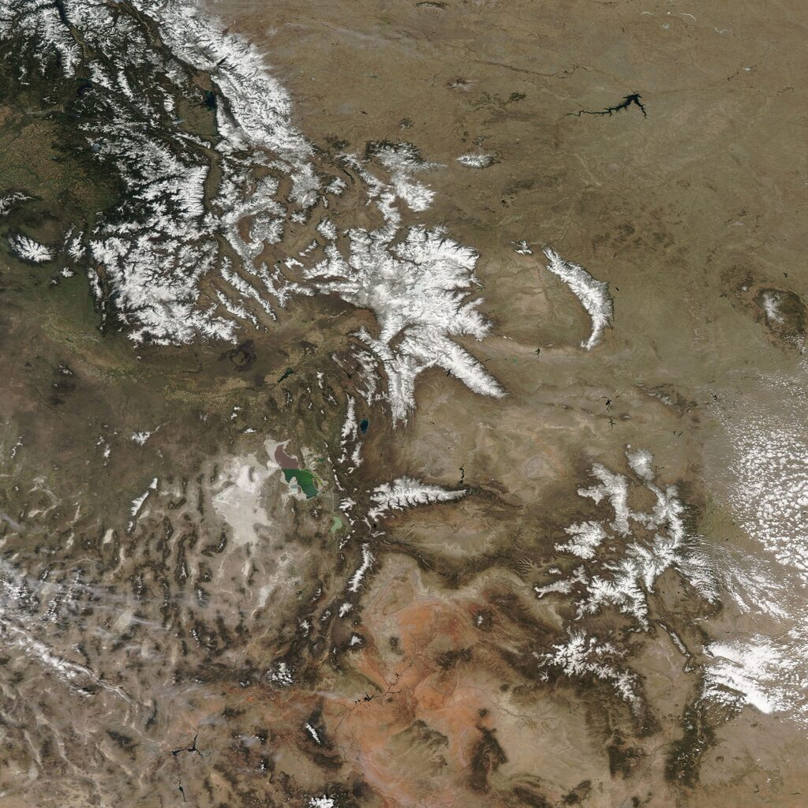
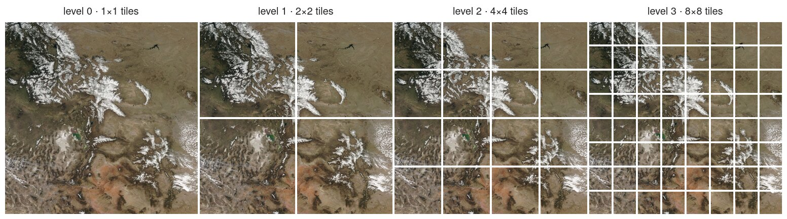

# satmap

Makes a picture of a DayZ map, and the tiles ReCON's Live Map loads, from
the map's own satellite tiles (`layers\S_<x>_<y>_lco.paa` in one of its
data PBOs). It runs on Windows, Linux or macOS, with no DayZ Tools.

The map pictures come from the game's or the map mod's files, so they
can't be shared: run satmap on your own copy of the game to make them, and
use them on your own ReCON only.

## What it makes

Because DayZ map pictures can't be shared, the examples below use a
real-world satellite picture of the Western United States (the Rockies,
Great Salt Lake and the Colorado Plateau) in place of a game map. It was
put through the same `satmap -slice` a map's picture goes through.



It's sliced into tile levels. Each level has twice the columns and rows
of the one before it, and the Live Map loads only the tiles in view:



<sub>Image: NASA GSFC, MODIS Land Rapid Response Team (Jeff Schmaltz),
1 May 2018. Public domain. Cropped to a square and scaled down.</sub>

## Getting it

Each [release](../../releases) has it ready to run
(`satmap-windows-amd64.exe`, `satmap-linux-amd64`, `satmap-darwin-arm64`,
`satmap-darwin-amd64`). Or, with Go 1.22 or newer:

```
go install github.com/MowMdown/satmap@latest
```

## Making a map's picture and tiles

Point it at a PBO or a folder: it looks through every PBO in the folder
and its subfolders for tiles. For the official maps (Chernarus, Livonia,
Sakhal, Nasdara) that is the DayZ folder; for a map mod (Namalsk, Deer
Isle, ...), the mod's folder.

```
satmap "C:\Program Files (x86)\Steam\steamapps\common\DayZ"
satmap -world chernarusplus "C:\Program Files (x86)\Steam\steamapps\common\DayZ"
satmap "C:\Program Files (x86)\Steam\steamapps\common\DayZ\!Workshop\@Namalsk Island"
```

It writes `maps/<world>.jpg` and its tiles, `maps/<world>/`.

- When it finds more than one map, it lists them with their world names:
  run it again with `-world` and one of them (`-world enoch`; any part of
  the path works). The world name it guesses from the path is the file
  name; it has to be the one the ReCON mod reports (the `world` in
  `/api/mod/players`), so give `-world <that name>` if they differ.
- The tiles overlap; satmap measures by how much and crops it (`-crop N`
  to set it by hand). It keeps the picture's size rounded down to a
  multiple of 256 px, which drops the padding at the edges on the maps we
  know of (`-size N` to set it: on most maps 1 px is 1 m, so it is the
  map's size in metres).
- It writes 8192 × 8192 px (`-px` to change it, up to the satellite
  picture's own size). A whole map takes a few seconds.
- `-tiles=false` writes only the picture.

Put the picture and the folder in ReCON's data folder as `maps/<world>.jpg`
and `maps/<world>/` (with Docker, the `maps` folder next to the database).

## Tiles

A whole picture loads in full on every visit, and a big one (15360 px is
about 1 GB once a browser decodes it) can crash the page, on a phone
especially. So satmap also slices it into tiles, in levels:
`maps/<world>/0/` is the whole map in one tile, each level after it has
twice the columns and rows (`<column>_<row>.jpg`, column 0 at the west
edge, row 0 at the north), and the last is the picture's own pixels, with
`maps/<world>/tiles.json` describing them. Whatever the zoom, the Live Map
loads only the few tiles in view from the least detailed level that is
sharp enough.

To slice a picture you already have (a `.jpg` or `.png`), replacing
tiles already there:

```
satmap -slice maps/chernarusplus.jpg                 # writes maps/chernarusplus/
satmap -slice maps/chernarusplus/chernarusplus.png   # in its own folder: writes there too
```

The picture can stay in the tiles' folder: the Live Map only loads the
tiles, and slicing again leaves it there.

Tiles are at most 512 px (`-tile`); a 15360 px map is 6 levels, 1365
tiles, about 77 MB, sliced in a few seconds (it needs about 1.6 GB of
memory).

## License

MIT (see LICENSE). DayZ is a trademark of Bohemia Interactive a.s.; satmap
is an independent community project, not affiliated with or endorsed by
Bohemia Interactive.
